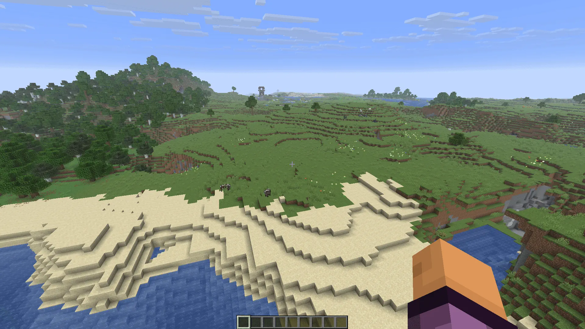

Accelerate removes vanilla's flight speed limits in worlds you host. Use the scroll wheel or the keybinds to go as fast as you like.

## ✨ Features

### Spectator mode

Scroll or use the keybinds to change your flight speed. The vanilla cap of 4x is removed.

### Creative mode

Hold the modifier key (Left Control by default) while flying, then scroll or use the keybinds. The scroll wheel changes your speed instead of your hotbar slot while you hold it. Let go of the modifier and you're back to normal creative flight.

## ⌨️ Controls

All keys can be changed in Controls, under the Accelerate category.

| Action              | Default      |
| ------------------- | ------------ |
| Fly Faster          | Page Up      |
| Fly Slower          | Page Down    |
| Reset Flight Speed  | Not bound    |
| Modifier (creative) | Left Control |

## ⚙️ Settings

Open the config screen from the Mods screen (Mod Menu on Fabric).

| Option           | Description                                                                                                                                               | Default     |
| ---------------- | --------------------------------------------------------------------------------------------------------------------------------------------------------- | ----------- |
| Max Speed        | The highest speed you can reach, from 1x to 1000x.                                                                                                        | 50x         |
| Scroll Steps     | **Progressive** keeps vanilla's small steps up to 4x and then multiplies your speed on every step. _Linear_ adds the same amount on every step.           | Progressive |
| Progressive Step | What each step above 4x multiplies your speed by, from 1.01x to 2x.                                                                                       | 1.15x       |
| Linear Step      | How much each step adds, from +0.1 to +10.                                                                                                                | +1.0        |
| Speed Display    | Shows your speed above the hotbar after you change it, as a multiplier, in blocks per second, km/h, Mach or chunks per second. It can also be turned off. | Multiplier  |
| Remember Speed   | Keeps your speed when you rejoin, respawn or switch game modes. In creative, each hold of the modifier starts at your last speed.                         | Off         |

## 🌐 Translating

Translations are managed on [Crowdin](https://crowdin.com/project/creeperkatze-mc-mods). You can contribute without any technical knowledge, just pick your language and start translating.
