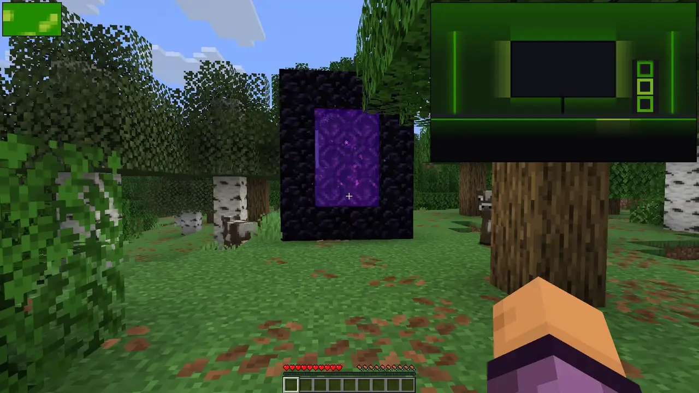

Illuminate brings your room into the game with ambient RGB lighting through OpenRGB and SignalRGB.

## ✨ Features

**🌅 World**

Your lights follow the sky, biome and time of day, darken in caves and flash with lightning.

**💥 Effects**

Your lights react when you take damage, burn, freeze, drown or drink a potion.

**🧭 Direction**

Lights placed to your left or right react to hits from that side.

## 🔧 Setup

**SignalRGB**

1. In the Illuminate settings, open **Devices** and press **Install** next to **SignalRGB Effect**. This copies the effect to `Documents\WhirlwindFX\Effects`.
2. Restart SignalRGB and select the **Illuminate** effect.
3. Place your devices on the SignalRGB canvas where they are around your screen.

**OpenRGB**

1. Start OpenRGB, open the **SDK Server** tab and press **Start Server**.
2. Enable OpenRGB in the Illuminate settings under **Devices**. The default address is `127.0.0.1:6742`.
3. Set where each device sits under **Device Positions** in the **OpenRGB** section of the **Devices** tab, so directional effects land on the right side.

You can use SignalRGB and OpenRGB at the same time, as long as each device is controlled by only one of them. A device controlled by both flickers. Turn it off in SignalRGB or set it to **Off** under **Device Positions** in the OpenRGB section.

## 🌐 Translating

Translations are managed on [Crowdin](https://crowdin.com/project/creeperkatze-mc-mods). You can contribute without any technical knowledge, just pick your language and start translating.
